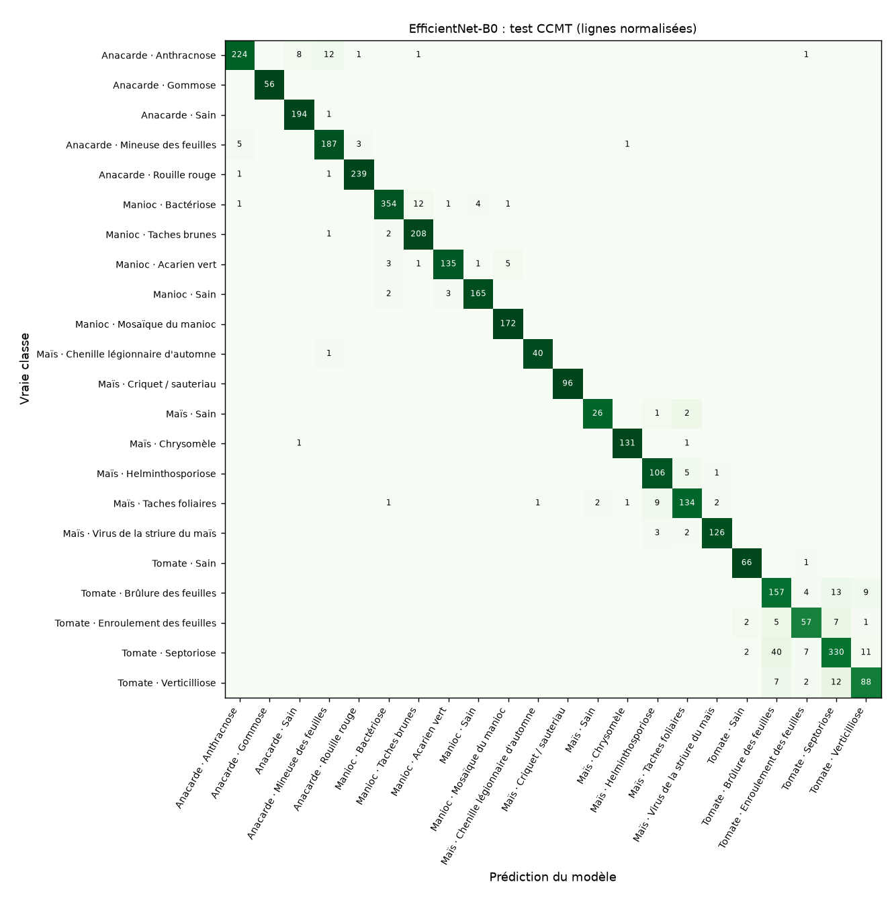
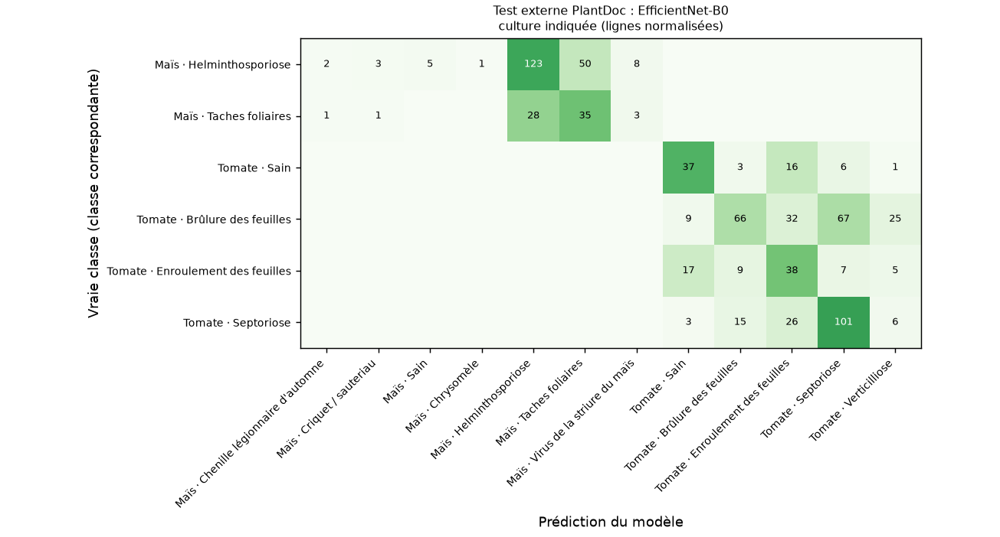
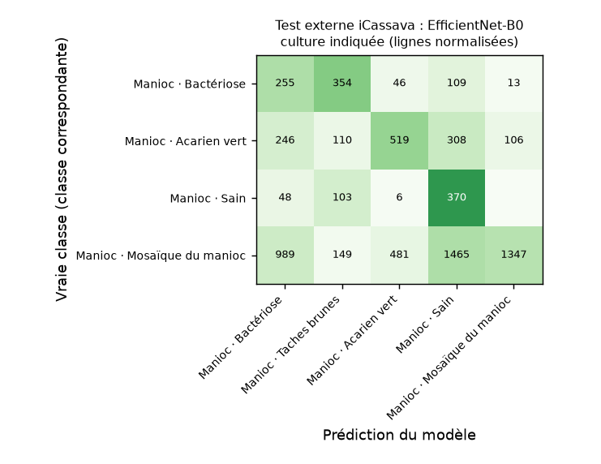
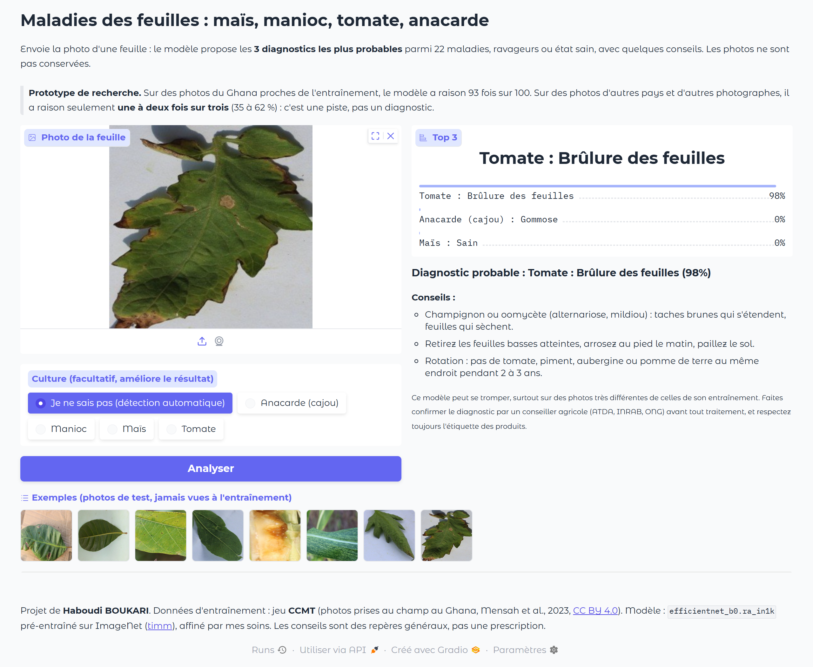

# Maladies des feuilles : maïs, manioc, tomate, anacarde

Un modèle de vision qui reconnaît, à partir de la photo d'une feuille, **22 maladies, ravageurs
ou états sains** sur quatre cultures importantes au Bénin et en Afrique de l'Ouest :
le **maïs**, le **manioc**, la **tomate** et l'**anacarde** (cajou). Il est livré avec une démo web
(Gradio) et une petite API (FastAPI), et tourne sur un simple processeur.

- **Auteur :** Haboudi BOUKARI, élève-ingénieur (informatique, logistique et recherche opérationnelle), ENSGMM
- **Statut :** prototype de recherche, entraîné et évalué. Démo locale ; pas encore publiée en ligne.


## Résultats en bref

Modèle retenu : **EfficientNet-B0** (meilleur F1 macro de **validation** ; le test n'a servi qu'à la fin).

| Jeu de test | Images | Exactitude (22 classes) | Exactitude si la culture est indiquée | Top 3 |
|---|---|---|---|---|
| CCMT test (Ghana, même collecte que l'entraînement) | 3 519 | **93,5 %** | 93,6 % | 98,9 % |
| … dont images sans quasi-jumeau en entraînement | 1 851 | 88,8 % | | |
| PlantDoc (photos d'Internet, maïs + tomate) | 749 | **42,5 %** | 53,4 % (62,0 % sur les correspondances exactes) | 67,6 % |
| iCassava (paysans d'Ouganda, manioc) | 7 024 | **32,3 %** | 35,5 % | 52,6 % |

**Ce qu'il faut retenir :**

1. Sur des photos qui ressemblent à celles de l'entraînement, le modèle est bon : 93,5 % sur 22 classes,
   F1 macro 93,5 %, et une calibration correcte (erreur de calibration 1,9 %).
2. Ce chiffre est **optimiste**. Même après suppression des doublons, 47 % des images de test ont une image
   d'entraînement très proche (probablement la même plante ou la même parcelle, photographiée plusieurs fois). Sur ces images, l'exactitude
   est de 98,8 % ; sur les autres, de **88,8 %**. C'est ce second chiffre qui décrit le mieux une nouvelle photo
   prise dans les mêmes conditions.
3. Sur des photos **d'autres pays et d'autres photographes**, l'exactitude chute fortement (32 à 62 % selon le
   jeu et le mode), et le modèle reste **trop sûr de lui** (erreur de calibration de 26 à 32 %). C'est le
   « décalage de domaine » : fonds, appareils, stades de maladie et définitions des classes diffèrent.
   **Le modèle n'est donc pas prêt pour un usage au champ au Bénin** sans données locales.

MobileNetV3-Large donne presque les mêmes résultats sur CCMT (93,5 %) et un peu moins bons en externe
(39,9 % sur PlantDoc, 29,8 % sur iCassava). Tableau complet : [`results/comparaison.md`](results/comparaison.md).

### Détail par classe (test CCMT)

Les classes les plus difficiles sont celles de la tomate : brûlure des feuilles (F1 0,80), enroulement (0,79),
verticilliose (0,81) et septoriose (0,88), qui se confondent entre elles. Au maïs, helminthosporiose et
taches foliaires se mélangent (0,92 et 0,91) : ces deux classes partagent même des photos identiques dans
le jeu d'origine. Le maïs sain (0,91) n'a que 29 images de test. Les autres classes atteignent au moins 0,94. Tableau : [`results/par_classe_ccmt_test.md`](results/par_classe_ccmt_test.md).



### Tests externes, classe par classe

Culture indiquée, modèle EfficientNet-B0 ([tableau complet](results/tests_externes_par_classe.md)) :

- **Manioc (iCassava)** : les plants sains sont bien reconnus (70 %), mais la **mosaïque** n'est retrouvée
  que dans 30 % des cas : le modèle la prend souvent pour une feuille saine ou une bactériose.
  Les photos iCassava montrent souvent la plante entière, de loin, quand CCMT montre une feuille de près.
- **Maïs et tomate (PlantDoc)** : l'helminthosporiose (64 %) et la septoriose (67 %) passent assez bien ;
  le virus jaune de la tomate (associé ici à « enroulement des feuilles ») et les brûlures précoces
  et tardives (correspondances approchées) passent mal.

| PlantDoc (culture indiquée) | iCassava (culture indiquée) |
|---|---|
|  |  |

### Exemples dans la démo

Sur les 8 photos d'exemple (jeu de test CCMT), 7 sont bien reconnues. La septoriose de la tomate est prise
pour une brûlure des feuilles, avec 98 % de confiance : une erreur sûre d'elle, typique des classes de
la tomate.

| Manioc, culture indiquée | Une erreur : septoriose prise pour une brûlure |
|---|---|
|  |  |

## Limites

- **Décalage de domaine** : voir plus haut. Toutes les photos d'entraînement viennent du Ghana, d'une seule
  campagne de collecte. Il faudrait des photos béninoises, prises par des producteurs au téléphone.
- **Étiquettes bruitées** : 224 fichiers identiques portent deux étiquettes dans CCMT ; helminthosporiose et
  taches foliaires du maïs se chevauchent. Ces images ont été écartées, mais d'autres erreurs d'étiquetage
  restent sans doute.
- **Correspondances approchées** : PlantDoc ne distingue pas les mêmes maladies que CCMT (« early blight »,
  « late blight », « gray leaf spot »). Les chiffres sont donc donnés avec et sans ces classes.
- **Pas de classe « autre »** : une photo qui n'est pas une feuille, ou une maladie hors des 22 classes
  (par exemple la striure brune du manioc), recevra quand même l'une des 22 étiquettes. L'avertissement
  « le modèle hésite » (confiance < 50 %) aide un peu, mais ne suffit pas.
- **Contrôle de fuite approximatif** : la proximité test/entraînement est mesurée avec les représentations
  du modèle lui-même (similarité cosinus ≥ 0,95), ce qui n'est qu'un indicateur.
- **Une seule graine aléatoire** : pas d'intervalle de confiance entre plusieurs entraînements.
- **Conseils** : repères généraux tirés des pratiques courantes, à valider par un agronome. Aucun nom de
  produit ni dose n'est donné.

### Pistes pour la suite

Collecter quelques centaines de photos au Bénin avec des conseillers (ATDA, INRAB) ; affiner le modèle
dessus ; ajouter une classe « autre / pas une feuille » ; entraîner sur GPU avec des images plus grandes ;
exporter le modèle pour un téléphone hors ligne (ONNX ou TFLite).

## Pourquoi ce projet

Au Bénin, le maïs, le manioc, la tomate et l'anacarde font vivre beaucoup de petits producteurs.
Une maladie repérée tôt (mosaïque du manioc, striure du maïs, chenille légionnaire…) se gère mieux,
mais un conseiller agricole n'est pas toujours disponible. L'idée : une photo prise au téléphone
donne une **première piste**, à confirmer ensuite par un conseiller.

Le piège classique de ce genre de projet est de s'entraîner sur **PlantVillage** (photos de
laboratoire, une feuille sur fond uni) : on obtient plus de 99 % de précision en test,
puis le modèle s'effondre sur une vraie photo prise au champ. J'ai donc choisi
des **photos prises au champ en Afrique de l'Ouest**, et je mesure le modèle sur des photos
**d'autres pays et d'autres photographes**.

## Données et licences

| Jeu de données | Rôle | Contenu | Licence |
|---|---|---|---|
| [CCMT](https://data.mendeley.com/datasets/bwh3zbpkpv/1) (Mensah et al., 2023, *Data in Brief*) | entraînement, validation, test | 24 881 photos brutes prises dans des fermes du Ghana, validées par des phytopathologistes, 22 classes | CC BY 4.0 |
| [PlantDoc](https://github.com/pratikkayal/PlantDoc-Dataset) (Singh et al., 2020) | **test externe** maïs et tomate | photos trouvées sur Internet, conditions réelles | CC BY 4.0 |
| [iCassava 2019](https://www.tensorflow.org/datasets/catalog/cassava) (Makerere AI Lab, NaCRRI) | **test externe** manioc | photos de paysans ougandais au champ | non précisée : utilisé **seulement pour tester**, jamais redistribué |

Les images ne sont **pas** dans ce dépôt : elles sont téléchargées depuis leur source par le pipeline.
Les quelques photos du dossier `samples/` viennent du jeu de test CCMT (CC BY 4.0, Mensah et al., 2023),
réduites à 512 px.

### Les 22 classes

| Culture | Maladies | Ravageurs | |
|---|---|---|---|
| Anacarde | anthracnose, gommose, rouille rouge | mineuse des feuilles | sain |
| Manioc | bactériose, taches brunes, mosaïque | acarien vert | sain |
| Maïs | helminthosporiose, taches foliaires, virus de la striure | chenille légionnaire, criquet, chrysomèle | sain |
| Tomate | brûlure des feuilles, enroulement (virus), septoriose, verticilliose | | sain |

## Méthode

### 1. Nettoyage des données

Les chiffres réels de l'archive CCMT diffèrent un peu de l'article (25 220 fichiers). Avant tout
découpage, chaque image est réduite (côté court 320 px) et deux empreintes sont calculées :

- **sha256** pour les copies exactes : 831 doublons exacts, 94 images illisibles ;
  224 fichiers identiques portent **deux étiquettes différentes** (dont 171 entre
  « helminthosporiose » et « taches foliaires » du maïs : les deux classes se chevauchent dans le jeu) ;
- **pHash** (distance ≤ 2) pour les quasi-copies (recadrages, ré-encodages) : 1 155 paires.
  Le seuil a été choisi en regardant les paires entre cultures différentes : à 4, on relie déjà
  des photos sans rapport.

Les images reliées forment des **groupes** (union-find). Un groupe dont les images ont des
étiquettes contradictoires est écarté (494 images). Le découpage 70/15/15 se fait **par groupe**
(StratifiedGroupKFold) : une photo et sa quasi-copie ne peuvent pas se retrouver l'une en
entraînement, l'autre en test. Résultat : 17 594 images d'entraînement, 3 519 de validation, 3 519 de test.

### 2. Entraînement

- Deux modèles pré-entraînés sur ImageNet (bibliothèque `timm`), comparés dans les mêmes conditions :
  **MobileNetV3-Large** (4,2 M paramètres avec 22 classes, rapide sur téléphone ou CPU) et **EfficientNet-B0** (4,0 M).
- 15 époques, AdamW (lr 1e-3, weight decay 0,05), OneCycle, label smoothing 0,1,
  poids de classe en 1/√effectif ; augmentations : recadrage aléatoire, retournements,
  rotation, couleurs, flou.
- Entraînés sur **CPU** (32 cœurs Modal) : le compte n'avait pas accès aux GPU.
  Environ 40 min pour MobileNetV3, 55 min pour EfficientNet-B0.
- Le meilleur état est choisi sur le **F1 macro de validation**, jamais sur le test.

### 3. Évaluation

- **Test CCMT** (3 519 images jamais vues, mêmes fermes du Ghana) : exactitude, F1 macro, top-3,
  rapport par classe, matrice de confusion.
- **Mode « culture connue »** : si l'utilisateur indique la culture, le modèle ne choisit
  qu'entre les maladies de cette culture.
- **Calibration** : une température est ajustée sur la validation, pour que « 80 % » veuille dire
  à peu près 80 %. L'erreur de calibration (ECE) est donnée.
- **Contrôle de fuite** : pour chaque image de test, on cherche l'image d'entraînement la plus
  proche (similarité cosinus des représentations). On compare l'exactitude des images de test
  très proches d'une image d'entraînement (≥ 0,95) à celle des autres.
- **Tests externes**, sur des photos d'autres pays, d'autres photographes, que le modèle n'a jamais vues :
  - **PlantDoc** (maïs, tomate ; 749 images) : ses classes ne recouvrent pas exactement celles de CCMT.
    Correspondances exactes : brûlure du maïs, septoriose, tomate saine, virus jaune → enroulement.
    Correspondances approchées : « gray leaf spot » → taches foliaires du maïs ; « early blight » et
    « late blight » → brûlure des feuilles de tomate. Les résultats sont donnés avec et sans les approchées.
  - **iCassava 2019** (manioc, Ouganda ; 7 024 images) : bactériose, acarien vert, mosaïque, sain.
    La striure brune (CBSD) n'existe pas dans CCMT, elle est exclue.

## Lancer le projet

### Démo et API (CPU, en local)

```bash
python -m venv .venv
.venv\Scripts\activate            # Windows (sous Linux/Mac : source .venv/bin/activate)
pip install -r requirements.txt
python app.py                     # démo : http://localhost:7860
uvicorn api.main:app --port 8000  # API : http://localhost:8000/docs
```

Exemple d'appel de l'API :

```bash
curl -F "file=@samples/cassava__mosaic.jpg" "http://localhost:8000/predict?crop=cassava"
```

### Refaire l'entraînement (Modal)

```bash
pip install -r requirements-dev.txt
modal setup                                          # connexion au compte Modal (une fois)
set LEAF_GPU=none                                    # PowerShell : $env:LEAF_GPU="none" ; ou LEAF_GPU=L4 avec un GPU
modal deploy modal_pipeline.py                       # l'app tourne chez Modal, même si le PC se déconnecte
python scripts/spawn.py fetch                        # télécharge les données dans un Volume Modal
python scripts/spawn.py split                        # doublons + découpage
python scripts/spawn.py train                        # entraîne les deux modèles en parallèle
python scripts/spawn.py evaluate                     # métriques et tests externes
modal run modal_pipeline.py::samples                 # photos d'exemple pour la démo
modal volume get leaf-disease-data runs results_modal/
modal volume get leaf-disease-data results results_modal/
python scripts/report.py                             # graphiques, tableaux, copie du modèle retenu
```

### Tests

```bash
pip install -r requirements-dev.txt
python -m pytest -q
```

## Structure

```
leaf_core/          cœur partagé : classes et conseils, modèle et prédiction, métriques
modal_pipeline.py   données → découpage → entraînement → évaluation, sur Modal
scripts/spawn.py    lance une étape sur l'app Modal déployée et attend sa fin
scripts/report.py   graphiques et tableaux à partir des résultats
scripts/captures.py captures d'écran de la démo (Playwright + Edge)
app.py              démo Gradio (point d'entrée Hugging Face Spaces)
api/main.py         API FastAPI : POST /predict
model/              modèle retenu (poids safetensors + meta.json)
results/            métriques, matrices de confusion, courbes
docs/captures/      captures d'écran de la démo
samples/            photos d'exemple (jeu de test CCMT)
tests/              tests rapides (python -m pytest -q)
```

## Licence

Code sous licence Apache 2.0. Les poids du modèle sont dérivés de CCMT (CC BY 4.0) :
toute réutilisation doit citer Mensah et al. (2023) :

> Mensah, P. K. et al. (2023). *CCMT: Dataset for crop pest and disease detection*. Data in Brief, 49, 109306.
> https://doi.org/10.1016/j.dib.2023.109306
